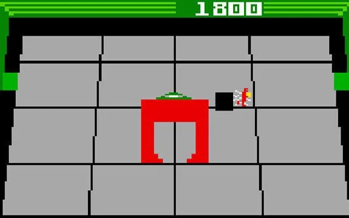
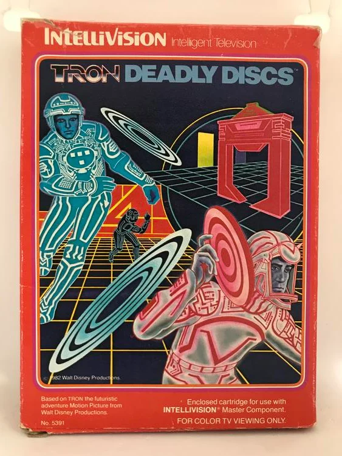
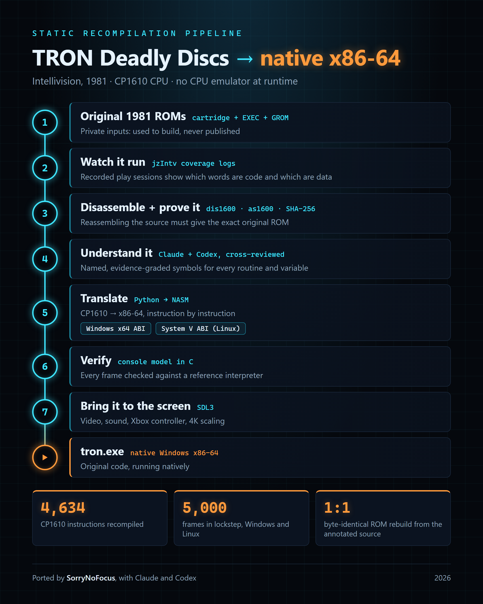
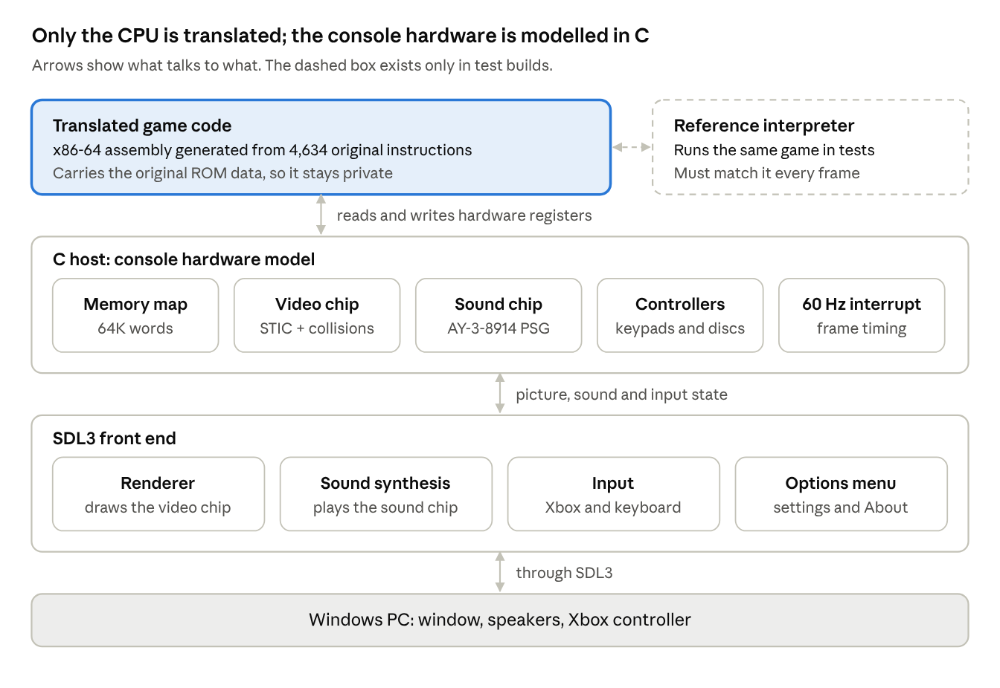
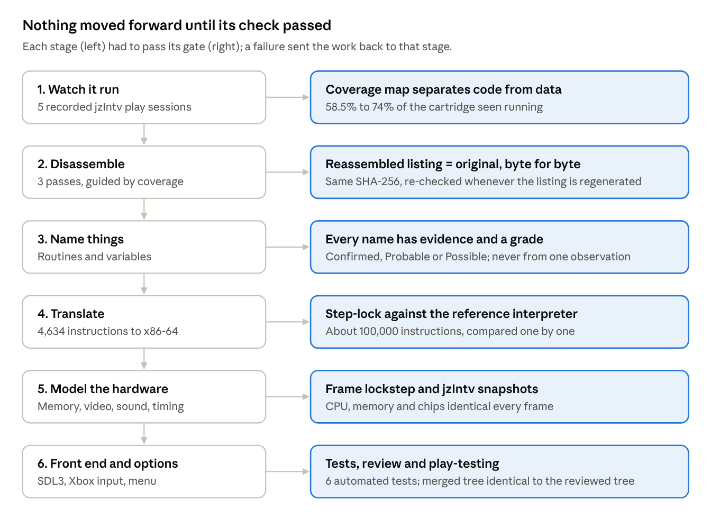
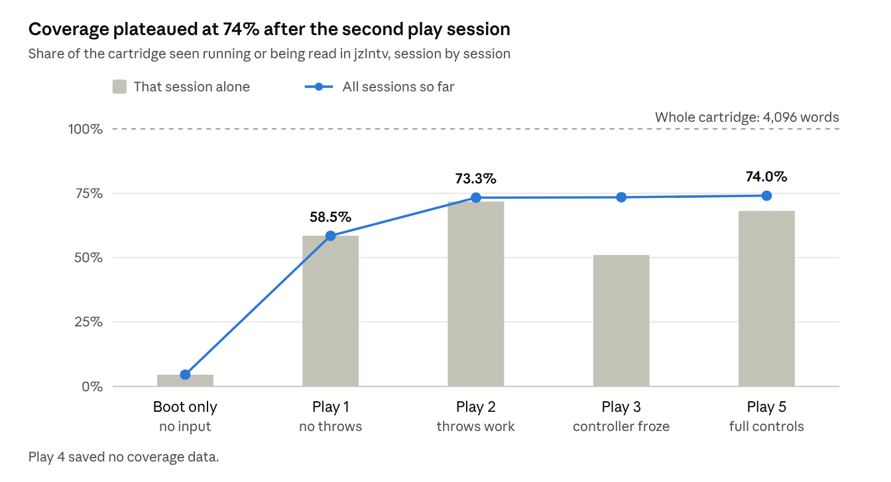

**Contents**

- [Why I did this](#why-i-did-this)
- [TL;DR](#tldr)
   - [The pipeline](#the-pipeline)
   - [By the numbers](#by-the-numbers)
   - [The interesting bits](#the-interesting-bits)
- [What this leaves out](#what-this-leaves-out)
- [How it was done](#how-it-was-done)
- [How the port fits together](#how-the-port-fits-together)
- [The audit](#the-audit)
- [Working with two AI agents](#working-with-two-ai-agents)
- [Lessons](#lessons)
- [What's next](#whats-next)
- [How it works: the technical notes](#how-it-works-the-technical-notes)
   - [Where it started](#where-it-started)
   - [Translating one instruction](#translating-one-instruction)
   - [Registers and memory](#registers-and-memory)
   - [Two calling conventions](#two-calling-conventions)
   - [The gates](#the-gates)
   - [The lockstep harness](#the-lockstep-harness)
   - [The hardware models](#the-hardware-models)
   - [The graphics: 520 bytes, no image files](#the-graphics-520-bytes-no-image-files)
   - [Keeping private material private](#keeping-private-material-private)
   - [What the code says about the game](#what-the-code-says-about-the-game)
   - [Inside the recompiler](#inside-the-recompiler)
   - [How much of the game the play sessions reached](#how-much-of-the-game-the-play-sessions-reached)
   - [Code that rewrites itself](#code-that-rewrites-itself)
- [Appendix: memory map](#appendix-memory-map)
- [Final thoughts](#final-thoughts)
- [Credits and tools](#credits-and-tools)

## Why I did this

> Emulation runs the old code. A remake replaces it. Static recompilation translates it: same game, new processor.

TRON: Deadly Discs now runs on my Windows PC as a native x86-64 program, played with an Xbox controller. It's the original game code, translated, not a remake, and there's no CPU emulator inside.

<div style="max-width: 575px; margin: 0 auto;">



*The arena in play: the red arch in the middle is the Recognizer, come to repair a door.*

</div>

I recorded a video as proof: the build folder deleted and everything rebuilt from scratch on camera, all the tests passing, then the freshly built game running with a controller.

<div style="max-width: 720px; margin: 0 auto;">

<div style="position: relative; aspect-ratio: 16 / 9;">
<iframe src="https://www.youtube-nocookie.com/embed/MiaeO_WMID4" title="I Turned a 1981 Intellivision Game into a Native Windows .exe (TRON: Deadly Discs)" style="position: absolute; inset: 0; width: 100%; height: 100%; border: 0;" allow="accelerometer; autoplay; clipboard-write; encrypted-media; gyroscope; picture-in-picture; web-share" referrerpolicy="strict-origin-when-cross-origin" loading="lazy" allowfullscreen></iframe>
</div>

*The proof video, about 20 minutes. [Watch it on YouTube](https://youtu.be/MiaeO_WMID4).*

</div>

I grew up in the era of the Atari 2600 and the Intellivision, and a few games stayed with me. Deadly Discs (Mattel Electronics, 1981) was one of my favorites: simple by today's standards, but incredibly entertaining. I've owned the console and the cartridge since 1998. For years I played it in emulators (Bliss and jzIntv), but I wanted it running natively on a modern PC.

<div style="max-width: 360px; margin: 0 auto;">



*The original box, model 5391. The art is marked 1982, though the cartridge's own header says 1981. Box art © Walt Disney Productions.*

</div>

The point was always to learn how the game worked. There's something fascinating about studying unfamiliar machine code, tracing its behavior, and eventually solving the puzzle.

- **2024:** I disassembled the original ROM and studied the instructions of its General Instrument CP1610 processor, very different from x86-64. I explored it in Ghidra, identified routines, mapped memory and patched a few spots to unlock cheats.
- **2025:** I built a Python prototype with a local LLM to understand the game's behavior by watching the original play. Then I set the project aside.
- **October 2026:** Recent examples of modders using LLMs to explore older games pulled me back. Over three days (11 to 13 October), working with Claude and OpenAI's Codex, the project became a static recompiler and a native port. It ended at version 0.11.0, with 42 commits, 18 numbered plans and a 21-question audit.

It was an iterative engineering process, not a one-prompt conversion. Reverse engineering takes time, patience and occasionally questioning your sanity.

## TL;DR

A 1981 Intellivision cartridge, statically recompiled: every original CP1610 instruction translated to x86-64, wrapped in a C model of the console's chips, and played natively on Windows with an Xbox controller. It's not an emulator of the CPU and not a remake. The [proof video](https://youtu.be/MiaeO_WMID4) shows a clean rebuild and the game running.

### The pipeline

1. **Coverage:** play the game in the jzIntv emulator and log which words run as code and which are read as data.
2. **Disassemble:** three passes guided by that log. Gate: the listing reassembles to the original, byte for byte.
3. **Name:** every routine and variable gets a name, a confidence grade and an evidence note.
4. **Translate:** a Python recompiler turns each instruction into a fixed x86-64 block with exact flags and cycle costs, for both Windows x64 and System V.
5. **Verify:** a test-only interpreter runs beside the translated code; CPU, memory and chip registers must match after every frame.
6. **Play:** a C11 host emulates the video chip, sound chip, controllers and 60 Hz interrupt; SDL3 draws, plays and reads input.

### By the numbers

| What | Number |
| --- | --- |
| Instructions translated | 4,634 (1,768 cartridge, 2,720 system ROM, 146 RAM boot code) |
| Cartridge size | 4,096 words; all its art is 65 one-bit cards, 520 bytes |
| Cartridge seen running in play sessions | 74% |
| Step-lock against the interpreter | \~100,000 instructions, identical |
| Frame lockstep, random input | 5,000 frames, identical on Windows and Linux |
| Bot combat run | 12,000 frames, identical |
| Names | 196 Confirmed, 123 Probable |
| Time for the port | 3 days: 42 commits, 18 plans, release 0.11.0 |

### The interesting bits

- **Flags follow the CP1610, not x86:** after a subtract its carry means "no borrow", so subtracts use `setnc`.
- **Speed comes from cycle counting:** each block charges its cost; when a frame's budget runs out, control returns to the host for the 60 Hz interrupt.
- **Two ABIs, one body:** only four macros differ between Windows x64 and System V; the CPU state lives in registers both conventions preserve.
- **Self-modifying boot code:** every version that ran was recorded, translated and guarded.
- **One known drift:** the video chip's bus stalls aren't cycle-exact, so one random seed differs from jzIntv. Different dice, same rules.
- **Audit gotcha:** a search for the ROM files' bytes found nothing in the executable; a search for the same 16-bit words in little-endian order found all three ROMs.

## What this leaves out

This is about the method, not the game's contents. The game's code, artwork, sound and names belong to their owners, so none of that is published here or anywhere else. I do NOT want to expose anything that violates IP.

Kept private:

- the ROM images (the cartridge and the console's two system ROMs), and where they came from;
- the disassembly and the annotated source. A memory map of names and addresses is published, but no code and no table contents;
- the generated x86-64 assembly and the built program. The program carries the original ROM data inside it, so it can't be shared;
- the decoded graphics themselves (how they're stored is explained with a made-up example), the sound data and the contents of the game's tables;
- the full audit report, which cites file paths, addresses and provenance details. Its findings are summarized below.

TRON and Intellivision are trademarks of their respective owners. This project isn't affiliated with or endorsed by them. Nothing here is legal advice or a claim that the port could be distributed.

## How it was done

The game wasn't rewritten. Every original instruction was translated, one by one, into equivalent x86-64 code, and each step had a check that could fail.

<div style="max-width: 560px; margin: 0 auto;">



*The whole pipeline on one page, from the original ROMs to the native tron.exe.*

</div>

1. **Watch it run.** I played five recorded sessions in the jzIntv emulator. Its coverage logs showed which bytes run as code and which are data. Coverage grew from 58.5% to 74% of the cartridge.
2. **Disassemble, then prove it.** Three disassembly passes, guided by that coverage. The gate: reassembling the annotated listing must give back the original cartridge byte for byte (same SHA-256). Nothing went forward until it did.
3. **Understand it.** Each routine and variable got a name, a confidence grade (Confirmed, Probable or Possible) and a note on the evidence. No name was given from a single observation.
4. **Translate.** A Python recompiler turns each instruction of the 1970s-era CP1610 CPU into a fixed x86-64 pattern, keeping its flag behavior and cycle cost. That's 4,634 instructions from the cartridge, the console's system ROM and some boot code the console copies into RAM. It writes assembly for both Windows and Linux calling conventions.
5. **Verify.** A separate CPU interpreter, used only for testing, runs beside the translated code. After every frame the two must match exactly: CPU registers, all of memory, and the video and sound chip state. Both platforms pass 5,000 frames with random input.
6. **Put it on screen.** A C host models the console hardware the code talks to, and an SDL3 front end draws the picture, plays the sound and reads an Xbox controller.

One caveat from step 5: Claude wrote both the translator and the interpreter from the same understanding, so a shared mistake would pass. The independent jzIntv emulator covers that gap. Its memory matches the port's everywhere except one timing-dependent random seed.

**Note:** The details of each step are in [the technical notes](#how-it-works-the-technical-notes).

## How the port fits together

The finished program has three layers, and *only* the top one comes from the original game.



The translated code talks to the console's chips as it always did, but the chips are now C models. The SDL3 layer turns their state into a modern window, sound and controller input. The reference interpreter never ships; it exists only so tests can compare against it.

## The audit

Before talking about the project in public, I asked for an audit of what it actually contains. Its most important finding: the native program needs no ROM files because it carries their full contents inside it, so the program stays private.

The audit answers 21 questions in four areas: method, original data, the C code, and copyright evidence. Every claim cites a file and line or a command anyone can re-run. Claude wrote it, Codex reviewed the first revision, and it reached revision 6 as the code changed. It isn't independent, it isn't legal advice, and it ends with a section on how to audit the audit.

| Finding | Confidence | What it changed |
| --- | --- | --- |
| The game logic is a mechanical translation of the original code, not a rewrite | High | The post says "translated", never "recreated" |
| The program embeds the complete cartridge and system ROM contents | High, measured twice | No builds are shared |
| The C host emulates the console's video and sound chips; only the CPU is translated | High | "No emulator" became "no CPU emulator" |
| No ROM image, listing or generated assembly was ever committed to git | High, checked by two reviewers | The ignore rules stay as they are |
| Some project docs quote short excerpts and tables from the ROM | High | Those docs stay private too |
| The sound chip's volume table matches an open-source library (Ayumi, MIT license) | High | Credit and license added to the About screen |
| One options hook could change game values even at default settings | High | Fixed in 0.10.1; now a true no-op |
| Translation is correct for every possible run | Medium-high: tested runs only | jzIntv kept as an independent check |
| Whether any of this is infringement or fair use | Can't be decided by a technical audit | A legal question, left open |

The audit also recommends a path to publishing something: split out a generic toolkit (the CPU decoder, the recompiler, the hardware models and the SDL3 shell) with no game-specific data, and have someone outside the project repeat the checks on it.

## Working with two AI agents

The agents wrote nearly all of the code; my job was directing the work, researching the original hardware, testing, chasing discrepancies and deciding what needed fixing.

The two agents didn't have fixed roles; I swapped them. At first, Claude did the main work (the research tools, the recompiler and the hardware model) while I delegated a lot of tasks to Codex, including reviewing Claude's work. Then I flipped them: Codex did the work (the SDL3 front end, the input handling, the options menu, symbol research and several fixes) and Claude reviewed it. Having each agent check the other caught mistakes the author had missed, in both directions.

Once Codex was doing the work, every change followed the same loop:

1. Codex works on its own task branch and pushes it.
2. Claude reviews that exact commit in a separate copy of the repo, without touching the shared working tree.
3. After approval, Codex squash-merges into main and deletes the branch.
4. Claude checks that what landed on main is identical to what it reviewed.

What made it work:

- **Numbered plans, never overwritten.** Each piece of work got a plan file (01 to 18). If the approach changed, a new plan was written. The history of decisions is all there.
- **A handoff file.** `AGENTS.md` holds the mission, the hard rules and the current status, so either agent (or a fresh session) can pick up cold.
- **Hard rules up front.** No ROM data in git. Nothing ships that loads a ROM file or carries a CPU interpreter. Every name needs evidence.
- **Real hands on a real controller.** My playtesting found an input bug that the automated tests passed, and a remembered enemy behavior that sent the agents back to the original code to explain it.

What to watch for: a premise repeated often enough starts to read as fact, to people and agents alike. The audit began by checking my own request and corrected several premises in it, including that the code was C++ (not sure *why* I said that, probably force of habit, but it's all in C), that there was no emulator (the video and sound chips *are* emulated) and that the game was from 1982 (incorrect - the ROM says 1981).

## Lessons

The single most useful thing was a *byte-exact gate early on*: once the listing rebuilt the original exactly, every later step had solid ground under it.

- **Make every step falsifiable.** A hash that must match, two implementations that must agree every frame. "It looks right" isn't a test.
- **Two implementations by one author share blind spots.** Keep a check written by someone else; here that was the jzIntv emulator.
- **Grade your names.** Confirmed, Probable and Possible, each with its evidence, kept guesses from hardening into facts. By the end, 196 names were Confirmed and 123 still Probable.
- **Keep the private material out of version control from the first commit.** Then the audit's history scan is a check, not a clean-up.
- **Audit before you announce.** The audit found that the program embeds the ROMs, which decided what could be shared before anything was posted.
- **Write plans down and keep them.** Agents forget between sessions; numbered plan files and a handoff file don't.

## What's next

The port is finished for my purposes: it plays well on a big screen with an Xbox controller, with a few options the original never had, such as more hits per life and a choice of fire controls. The translated core already passes its tests on Linux; the full playable build there is next. After that, I may split the game-agnostic parts into a separate toolkit with no game data, as the audit suggests, and point the same method at another Intellivision game.

## How it works: the technical notes

How the recompiler, the hardware model and the tests work. No game code or data appears here: code examples are made up or come from the project's own tools. Game addresses and names are only in the [memory map](#appendix-memory-map).

### Where it started

I didn't start with a recompiler. I started by taking the game apart, changing it, and seeing whether it still ran.

**2024: take it apart, change one word, put it back.** With the jzIntv developer tools, I disassembled the cartridge with `dasm1600`, edited the listing and reassembled it with `as1600`: a round trip that gave back a working cartridge. Then I made my own versions:

- a **"deadlier disc"** variant, where the returning disc can kill too (my note at the time: "returning disc can kill, including our self!");
- an **"invincible"** variant;
- four **colour changes** (TRON, his disc, the Warriors and their discs), applied as jzIntv cheat pokes instead of ROM edits.

Each gameplay patch changed a single word: the distance of one conditional branch. I found the spots with the emulator's debugger, watching what changed while the game played.

I also opened the cartridge in Ghidra, which has a CP1600 module, to study its contents. I cross-referenced Ghidra's decompiler output with the jzIntv disassembly, but ended up relying on the jzIntv tools. Unfortunately, most notes from that first stretch weren't saved: the working folder is gone, and only my command notes, a few listings and the patched cartridges survived.

**What the 2026 audit said about that listing.** It rebuilt the cartridge byte for byte, but it treated the whole ROM as code. About 27% of the cartridge is data (the header, text, graphics, colour tables), and it showed up as nonsense instructions, including 232 halts. That was fine for patching one word, but not for understanding the game, and it's why step 1 became coverage-guided disassembly. One more surprise: the file named as the original was the deadlier variant, one word different.

**2025: reconstruct it from behaviour.** Without reading any code, I rebuilt the game in Python and Pygame by watching the original and describing it to a local LLM. Over nine iterations it grew movement, throw and recall, enemies that chase and back off, blocking, freeze timers, dissolve animations and five waves. It's a re-imagining with nothing taken from the ROM, but it made me state the rules precisely. The real game turned out to differ: it never ends (there's no fifth wave or victory screen), and Warriors take one to four hits depending on their type, not a flat three.

**July 2026: the plan I didn't follow.** My handoff document planned a clean C# and MonoGame rewrite, and explicitly ruled out translating CP1610 instructions to x86-64. In the first planning session in October I chose the opposite: recompile the original code first, for an exact, playable build early, and do the understanding alongside it. The handoff's other goals carried over: an annotated disassembly, named routines and evidence for every name.

### Translating one instruction

Each CP1610 instruction becomes a small, fixed block of x86-64. The block updates the CPU state, sets the flags, charges the cycle cost and jumps to the next block. Below is the recompiler's real output for a made-up instruction, `ADDR R1,R2` (add R1 into R2), at a made-up address. It isn't from the game.

```asm
a_7A00:
    ; $7A00  00CA            ADDR R1,R2
    mov     ax, word [rbx+CPU_R+4]      ; load R2 (destination)
    mov     cx, word [rbx+CPU_R+2]      ; load R1 (source)
    add     ax, cx                      ; 16-bit add
    setc    byte [rbx+CPU_C]            ; carry
    seto    byte [rbx+CPU_OV]           ; overflow
    sets    byte [rbx+CPU_S]            ; sign
    setz    byte [rbx+CPU_Z]            ; zero
    mov     word [rbx+CPU_R+4], ax      ; store R2
    sub     dword [rbx+CPU_BUDGET], 6   ; this instruction costs 6 cycles
    jg      a_7A01                      ; budget left: next block
    mov     word [rbx+CPU_R+14], 0x7a01 ; else save the PC (R7)
    jmp     tron_yield                  ; and return to the host
```

Three details make the translation exact rather than approximate:

- **Flags follow the CP1610's rules, not x86's.** After a subtract, the CP1610's carry means "no borrow", the opposite of x86, so subtracts use `setnc`. Edge cases were checked by single-stepping small test programs in jzIntv.
- **Every instruction pays its cycle cost,** taken from the public CP1610 timing table. When a frame's budget runs out, the code returns to the host, which raises the console's 60 Hz interrupt and resumes. The game runs at the right speed because the cycle counts are right.
- **Blocks are labelled by original address.** Direct jumps go straight to their block. Computed jumps (a return address popped from the stack, a jump through a register) look the target up in a table indexed by original address.

### Registers and memory

The CP1610's state lives in a small C struct shared by the generated code and the host. Four x86-64 registers are reserved, all callee-saved on both Windows and Linux, so they survive every call into C.

| CP1610 | In the port | Note |
| --- | --- | --- |
| R0 to R7 (16-bit) | 8 words in the CPU struct | R6 is the stack pointer, R7 the program counter |
| Flags S, Z, OV, C and interrupt enable | 1 byte each in the struct | Set with `sets`, `setz`, `seto`, `setc` or `setnc` |
| The CPU struct itself | `rbx` | Every instruction reads and writes through it |
| 64K words of memory | an array of 16-bit words, `r12` | One flat image of the console's memory map |
| (scratch) | `r13`, `r14` | Hold an address and value across a host call |
| Time | a cycle budget in the struct | Counts down; at zero, control returns to the host |

Memory access has three speeds:

- **Ordinary RAM** at a fixed address is read or written inline, one `mov`. Writes to 8-bit RAM are cut to 8 bits, as on the real hardware.
- **ROM at a fixed address** can't change, so its value is folded into the instruction as a constant.
- **Memory-mapped hardware** (video chip, sound chip, controllers) and any address computed at run time go through a call into the C host, which decides what that address means.

### Two calling conventions

The generator writes two assembly files whose instruction bodies are identical; only a short section at the top differs. Windows and Linux disagree on how C functions are called, and that matters every time translated code calls the host.

|  | Windows x64 | System V (Linux, BSD, macOS) |
| --- | --- | --- |
| First two arguments | `rcx`, `rdx` | `rdi`, `rsi` |
| Stack space the caller reserves | 32 bytes of shadow space | none (a 128-byte red zone instead) |
| Registers a function must preserve | `rbx`, `rbp`, `rdi`, `rsi`, `r12` to `r15`, `xmm6` to `xmm15` | `rbx`, `rbp`, `r12` to `r15` |
| Calls into C | direct `call` | through the PLT, for position-independent code |
| NASM output format | `-f win64` | `-f elf64` |

The difference sits in four macros: enter, leave, read from the host, write to the host. Here is the host read on each side:

```asm
; Windows x64                        ; System V
%macro HOST_READ 0                   %macro HOST_READ 0
    mov     rcx, rbx  ; CPU struct       mov     rdi, rbx
    mov     edx, r13d ; address          mov     esi, r13d
    call    tron_host_read               call    tron_host_read wrt ..plt
%endmacro                            %endmacro
```

Choosing `rbx` and `r12` to `r14` for the CPU state pays off here: they're preserved under both conventions, so no translated block needs to save anything around a host call. Both builds pass the same 5,000-frame lockstep test.

### The gates

Every stage had a check that could fail, and nothing moved on until it passed.



The two strongest gates are the byte-exact reassembly and the per-frame lockstep. Together they show the listing is the real program and the translation behaves like it, at least on every path the tests reach.

### The lockstep harness

Two machines run side by side in one test program: one runs the translated x86-64, the other a plain CP1610 interpreter written only for testing. They get the same controller input, and after every frame the harness compares everything:

- all eight registers, every flag, the interrupt enable and the total cycle count;
- all 65,536 words of memory;
- every video chip and sound chip register.

The first difference stops the run and prints the frame, the address and both values. A clean run prints:

```text
LOCKSTEP OK: 5000 frames, 74834289 cycles, translated x64 == reference interpreter (CPU, 64K memory, STIC, PSG) at every frame
```

| Test | What drives it | Result |
| --- | --- | --- |
| Step-lock | \~100,000 single instructions, compared after each one | Identical |
| Idle | 600 frames, no input | Identical on both ABIs |
| Random input | 5,000 frames of random controller input | Identical on both ABIs |
| Bot | 12,000 frames of a test bot that aims and throws (collisions, scoring, several waves) | Identical on both ABIs |
| jzIntv cross-check | Memory snapshots from the jzIntv emulator at 8 points from boot to 2 seconds | Identical except one random seed |

Why the seed differs: the console's video chip briefly takes over the memory bus several times a frame, and the system ROM stirs its random number generator while it waits. The headless host doesn't model those stalls to the exact cycle, so the stirring count drifts. The result is a different random sequence, not different rules, and I chose not to chase it.

### The hardware models

The translated game only writes to chip registers; the C host and the SDL3 front end decide what those writes look and sound like. These parts were written from public hardware documentation and checked against the jzIntv emulator, not taken from the ROM.

| Part | Built from | Checked by |
| --- | --- | --- |
| Video chip renderer (STIC) | The public STIC programming reference; palette sampled from jzIntv's documentation | Play-testing |
| Sprite collisions | The STIC reference; the border band inferred from jzIntv memory dumps | Every collision bit in three recorded jzIntv sessions reproduced |
| Sound chip (AY-3-8914) | The chip's public data sheet | Register logs; a listening comparison |
| Clocks | 3.579545 MHz master clock: CPU at ÷4, sound ticks at ÷16 (223,722 Hz) | The 1982 Intellivision II Service Manual |

**The sound chip's noise generator turned into a small investigation.** It's a 17-bit shift register, and sources disagree on its feedback taps:

- The Intellivision Wiki's formula gives a sequence 114,681 steps long, which isn't the maximum for 17 bits.
- The formula in our synthesizer gives the maximal 131,071 steps (2^17 − 1).
- A transistor-level model traced from photos of a decapped sister chip (AY-3-8910) also gives 131,071, and matches our sequence exactly, inverted.

So the wiki's mask is probably a one-bit transcription error. That's still unconfirmed for the 8914 itself.

**One part needed a credit.** The audit found that the synthesizer's 16-step volume table and its noise formula match Ayumi, an MIT-licensed AY emulator by Peter Sovietov. The credit and the licence text were added to the source and to the program's About screen.

### The graphics: 520 bytes, no image files

The game has no image files. Every sprite and arena tile is an 8×8, one-bit "card" stored inside the cartridge: 65 cards, 520 bytes of pixel data for the whole game. A modern game ships its art as separate PNGs or textures you could open in an editor; here the art only exists as numbers in the program.

- **60 cards** draw everything that moves: TRON, the Warriors, the discs, the Recognizer and the effects. **5 cards** draw the arena.
- **Colour isn't stored with the pixels.** The game picks a colour from the console's 16-colour palette for each object as it draws it, which is why my 2024 colour cheats could recolour things without touching the art.
- **Taller sprites stack two cards.** The video chip can draw a moving object as 8×16, using two cards one above the other.
- **Animation is a pointer change.** A running figure is a few cards shown in turn; the game just points the sprite at the next card.
- **At boot, the game copies its cards into the console's graphics RAM.** A separate graphics ROM in the console holds another 256 built-in cards, mostly the font.

Here's how one card is stored, using a card I made up (a small disc, not from the game). Each row of 8 pixels is one byte:

```text
row  pixels     bits      byte
 0   ..####..   00111100  $3C
 1   .#....#.   01000010  $42
 2   #..##..#   10011001  $99
 3   #.#..#.#   10100101  $A5
 4   #.#..#.#   10100101  $A5
 5   #..##..#   10011001  $99
 6   .#....#.   01000010  $42
 7   ..####..   00111100  $3C
```

Decoding the real cards worked the same way in reverse: read 8 words from the address in the cartridge header, and print each one as a row of pixels.

Where each of these parts lives in memory, by name: [memory map](#appendix-memory-map).

### Keeping private material private

The rule from the first commit: nothing from the ROM goes into git. Everything ROM-derived can be regenerated locally, so the repository holds only tools, the host, the front end and notes.

The ignore file is organised by why something is excluded:

- **ROM images:** every cartridge and system ROM format.
- **ROM-derived source:** disassembly listings and the generated x86-64 assembly.
- **ROM-derived traces and images:** memory dumps, decoded graphics, screenshots and render tests. One exception is kept on purpose: coverage maps hold only address ranges, so they stay in as evidence.
- **Build output:** executables and object files, since the built program contains the ROM data.

The audit's checks are generic git commands that anyone can re-run on their own project:

```bash
git log --all --diff-filter=A --name-only --format= | sort -u   # every path ever committed
git fsck --no-reflogs --unreachable                             # local objects never pushed
git ls-remote --heads origin                                    # what is on the remote
git status --ignored --porcelain                                # ignored local files
```

**A naive binary scan gives a false all-clear.** Searching the executable for the ROM files' bytes found nothing. The ROM files store 16-bit words big-endian, while the program holds them little-endian in memory. Searching for the same values as 16-bit little-endian words found all three ROM images intact. If you audit a port, search for the data in the form the program uses, not the form on disk:

```python
import struct, sys
exe = open(sys.argv[1], 'rb').read()
rom = open(sys.argv[2], 'rb').read()
words = [(rom[i] << 8) | rom[i + 1] for i in range(0, len(rom), 2)]
print(exe.find(rom), exe.find(b''.join(struct.pack('<H', w) for w in words)))
```

### What the code says about the game

The original instruction booklet is a good guide, and reading the code turned its loose wording into exact rules. You fight three Warriors at a time in an arena with twelve doors, with one disc that bounces off the walls and comes back. A block destroys the incoming disc and scores as much as a knockout.

| The booklet says | The code shows |
| --- | --- |
| Shoot the Leader first | While a Leader is on the grid, every Warrior reacts faster and aims straighter |
| Brown discs are dangerous | A brown disc carries a double-damage flag: one hit counts as two |
| White discs chase you "like a guided missile" | A white disc re-aims at TRON on a fixed timer until it's blocked or hits a wall. It's possible from 20,000 points; when you meet one is chance |
| A returning disc is harmless | It still steers itself back to its owner, but does no damage on the way |
| The Recognizer comes to repair jammed doors | The game counts Warriors arriving through jammed doors and sends it on the 7th. A teleport can also call it |
| Its eye is the weak spot | Only in the moment the eye turns white, for 10 times the current Warrior value |
| TRON can take a few hits | 3 hits per wave, 4 above 20,000 points, 5 above 100,000; one hit recovers every few seconds |
| The Warriors get tougher | Points per Warrior climb from 50 to 10,000 in 15 steps as your score rises; orange Guards with a one-touch stick arrive at 1,000,000 |

**One rule surprised us.** The title screen picks a slower game speed (Slow, Slower or Slowest) if you start with keypad 1, 2 or 3, and any other key starts at full speed. A controller mapping can send those keys by accident, so the port starts a game only from Enter or the controller's Start button.

### Inside the recompiler

The recompiler is about 700 lines of Python plus a 190-line CP1610 decoder, and most of it is short, table-like rules. Three excerpts follow, copied as they stand; the game-specific settings in the same file are left out.

**Register-to-register arithmetic.** One rule covers six instructions. Each maps to one x86 operation; only the flag handling differs:

```python
if o in ("MOVR", "ADDR", "SUBR", "CMPR", "ANDR", "XORR"):
    s, d = ins.src, ins.reg
    if o == "MOVR":
        code += self.reg_to_ax(s, nxt) + self.flags_sz()
        store_ax(d)
    else:
        code += self.reg_to_ax(d, nxt)
        code.append(f"    mov     cx, {nxt:#06x}" if s == 7 else f"    mov     cx, {self.R(s)}")
        x86 = {"ADDR": "add", "SUBR": "sub", "CMPR": "sub", "ANDR": "and", "XORR": "xor"}[o]
        code.append(f"    {x86:<7} ax, cx")
        if o in ("ADDR", "SUBR", "CMPR"):
            code.append("    setc    byte [rbx+CPU_C]" if o == "ADDR" else "    setnc   byte [rbx+CPU_C]")
            code.append("    seto    byte [rbx+CPU_OV]")
        code += ["    sets    byte [rbx+CPU_S]", "    setz    byte [rbx+CPU_Z]"]
        if o != "CMPR":
            store_ax(d)
```

Reading R7 (the program counter) as a source gives the address of the next instruction, which the generator knows in advance, so it becomes a constant. A compare is a subtract that doesn't store its result.

**Cycle costs,** from the public CP1610 timing table:

```python
def cycles(i, dbd=False, taken=False):
    """Microcycles (jzIntv/CP1600 reference table; SDBD adds 2 to the next insn)."""
    o = i.op
    if o in ("HLT", "SDBD", "EIS", "DIS", "TCI", "CLRC", "SETC"):
        return 4
    if o == "J":
        return 12
    if o in R1_OPS.values() or o in ("GSWD", "NOP", "SIN"):
        return 7 if i.reg >= 6 and o not in ("GSWD", "NOP", "SIN") else 6
    if o in SHIFT_OPS:
        return 8 if i.two else 6
    if o in RR_OPS.values():
        return 7 if i.reg >= 6 else 6
    if o == "BRANCH":
        return 9 if taken else 7
    extra = 2 if dbd else 0
    if o == "MVO":
        return (11 if i.mode == "dir" else 9) + extra
    if i.mode == "dir":
        return 10 + extra
    if i.mode == "ind" and i.src == 6:
        return 11 + extra
    return 8 + extra
```

**Moving to the next block.** Some CP1610 instructions can't be interrupted, so the budget check only happens after those that can. If the target was translated, it's a direct jump; if not, the address goes through the run-time lookup table.

```python
def goto(self, target, interruptible):
    lab = self.label(target)
    if interruptible:
        if self.has(target):
            return [f"    jg      {lab}", f"    mov     {self.R(7)}, {target:#06x}", "    jmp     tron_yield"]
        return [f"    mov     {self.R(7)}, {target:#06x}", "    jg      tron_dispatch", "    jmp     tron_yield"]
    if self.has(target):
        return [f"    jmp     {lab}"]
    return [f"    mov     {self.R(7)}, {target:#06x}", "    jmp     tron_dispatch"]
```

### How much of the game the play sessions reached

Two real play sessions took coverage to 73% of the cartridge; the later ones added less than a point.



The remaining 26% was never seen running or being read. That's why the recompiler doesn't rely on coverage alone: it also translates everything the disassembly identifies as code.

### Code that rewrites itself

A static recompiler assumes the code doesn't change. During boot, the console's system ROM breaks that assumption: it copies a short program into RAM and runs it, and that program unpacks itself by rewriting instructions further down before it reaches them.

The first approach, a memory snapshot of the RAM code, was wrong: it caught the code before the rewrite. The fix had three parts:

1. **Record what actually runs.** The reference interpreter has a trace mode that logs every RAM instruction it executes, with the exact words it found there. That gave 146 instruction addresses; one of them ran in several different versions.
2. **Translate every version.** Each recorded version becomes its own x86-64 block. Where an address has more than one, a small selector block in front compares the words currently in memory and jumps to the matching version.
3. **Guard every block.** Each translated RAM instruction first checks that memory still holds the words it was translated from. If not, the program stops with a "RAM-code guard" error instead of running the wrong code.

```asm
; selector for an address with several recorded versions (shape only)
    cmp     word [r12+ADDR*2], VERSION0_WORD0
    jne     not_v0
    jmp     block_v0
not_v0:
    cmp     word [r12+ADDR*2], VERSION1_WORD0
    ...
    jmp     tron_guard_fail   ; nothing matched: stop, don't guess
```

If the guard ever fires, the cause is a version that was never recorded. That's the right way to fail: loud and immediate, rather than quietly running the wrong code.

## Appendix: memory map

Where things live in the cartridge, the console's system ROM and RAM, by name. Addresses are facts about the hardware and the cartridge. Names marked Confirmed or Probable are this project's own, each backed by an evidence note. No code, no table contents and no research comments appear here, and the 171 branch labels inside routines are left out.

<details>
<summary>System ROM routines the game calls</summary>

The console's built-in system ROM (the EXEC) runs the frame loop, moving objects, timers and sound; the game calls these 33 routines. Most names come from jzIntv's disassembler and *De Re Intellivision*, the public programming reference. A few, such as the object-link and bit helpers, were named by this project from controlled tests.

| Address | Name |
| --- | --- |
| `$1000` | `X_RESET` |
| `$1004` | `X_ISR` |
| `$10AB` | `X_READ_ROM_HDR` |
| `$141C` | `X_SET_OBJ_FACING` |
| `$1628` | `X_DIR_TO_VEL_INLINE` |
| `$1629` | `X_DIR_TO_VEL` |
| `$169E` | `X_RAND2` |
| `$16B2` | `X_INIT_MOB` |
| `$16B4` | `X_INIT_MOBS` |
| `$16CF` | `X_OBJ_LINK_SET` |
| `$16D5` | `X_OBJ_LINK_CLEAR` |
| `$16DB` | `X_CLEAR_BIT_INLINE` |
| `$16E6` | `X_SET_BIT_INLINE` |
| `$16F7` | `X_POINT_IN_RECT` |
| `$1738` | `X_FILL_ZERO` |
| `$1741` | `X_FILL_MEM` |
| `$174F` | `X_PACK_BYTES` |
| `$1757` | `X_UNPK_BYTES` |
| `$1760` | `X_OBJ_ACTIVE` |
| `$1772` | `X_OBJ_POS_REL` |
| `$1777` | `X_OBJ_POS` |
| `$17A3` | `X_OBJ_DIST` |
| `$17AE` | `X_OBJ_DEACTIVATE` |
| `$187B` | `X_PRINT_R5` |
| `$18AD` | `X_PRNUM_ZRO` |
| `$18C5` | `X_PRNUM_RGT` |
| `$19A1` | `X_AIM_AT_POINT_A` |
| `$19A3` | `X_AIM_AT_POINT` |
| `$1A2F` | `X_VEC_TO_DIR` |
| `$1BBB` | `X_PLAY_SFX1` |
| `$1BBE` | `X_PLAY_SFX2` |
| `$1DFB` | `X_DIV` |
| `$1EB4` | `X_STOP_SFX` |

</details>

<details>
<summary>The game's RAM map</summary>

Where the game keeps its state: score, wave, timers, door and Recognizer bookkeeping, and eight object slots (TRON, his disc, the Warriors and theirs). All 60 names are Confirmed. It's the kind of map cheat-makers and speedrunners publish for many games.

| Address | Name |
| --- | --- |
| `$0119` | `exec_min_y` |
| `$011A` | `exec_linked_object_mask` |
| `$0129` | `ai_pace_half` |
| `$012B` | `ai_update_timer` |
| `$012D` | `replacement_spawn_timer` |
| `$015D` | `game_over_flag` |
| `$015E` | `object_event_scratch` |
| `$015F` | `object_target_or_door_scratch` |
| `$0160` | `tron_boundary_side_scratch` |
| `$0161` | `door_scan_stride` |
| `$0162` | `pending_return_flag` |
| `$0163` | `block_mode` |
| `$0164` | `motion_direction_scratch` |
| `$0165` | `current_object_index` |
| `$0166` | `warrior_count` |
| `$0167` | `warrior_behavior_types` |
| `$016D` | `wave` |
| `$016E` | `ai_pace` |
| `$016F` | `warriors_to_spawn` |
| `$0170` | `tron_boundary_direction_latch` |
| `$0171` | `arena_last_object_index` |
| `$0172` | `recognizer_pending` |
| `$0173` | `recognizer_active` |
| `$0174` | `recognizer_door_index` |
| `$0175` | `disc_reflection_axis` |
| `$0176` | `recognizer_sound_state` |
| `$0177` | `jammed_door_encounters` |
| `$0178` | `replacement_spawn_flag` |
| `$0317` | `score_high` |
| `$0318` | `score_low` |
| `$031D` | `obj0_tron` |
| `$031E` | `obj0_tron_def` |
| `$0321` | `obj0_tron_vel` |
| `$0322` | `obj0_tron_mode` |
| `$0323` | `obj0_tron_timer` |
| `$0324` | `obj0_tron_pace_health` |
| `$0325` | `obj1_player_disc` |
| `$0326` | `obj1_player_disc_def` |
| `$0329` | `obj1_disc_vel` |
| `$032A` | `obj1_disc_mode` |
| `$032B` | `obj1_disc_timer` |
| `$032C` | `obj1_disc_speed` |
| `$032D` | `obj2_attributes` |
| `$0331` | `obj2_vel` |
| `$033D` | `obj4_attributes` |
| `$033E` | `obj4_def` |
| `$0342` | `obj4_mode` |
| `$0343` | `obj4_timer` |
| `$0347` | `obj5_x` |
| `$0348` | `obj5_y` |
| `$034A` | `obj5_mode` |
| `$034D` | `obj6_attributes` |
| `$034F` | `obj6_x` |
| `$0350` | `obj6_y` |
| `$0351` | `obj6_vel` |
| `$0354` | `obj6_pace_health` |
| `$0357` | `obj7_x` |
| `$0358` | `obj7_y` |
| `$0359` | `obj7_vel` |
| `$035D` | `controller_table_ptr` |

</details>

<details>
<summary>The game's routines</summary>

The entry points of the cartridge's code, in address order: a table of contents for the program, not the program itself. The last few entries are sound-effect definitions that the system ROM plays.

| Address | Name | Confidence |
| --- | --- | --- |
| `$503C` | `TitleScreenExtra` | Confirmed |
| `$5086` | `StopRecognizerEntryMotion` | Confirmed |
| `$509F` | `RestartRoundOrGameOver` | Confirmed |
| `$50C7` | `SetRecognizerDiscReflectionAxis` | Confirmed |
| `$50F3` | `ToggleRecognizerEyePhase` | Confirmed |
| `$5395` | `OnDiscInput` | Confirmed |
| `$53CA` | `OnKeypadInput` | Confirmed |
| `$542E` | `TronCallback` | Confirmed |
| `$5437` | `RestoreHumanoidHealthAndDiscPace` | Confirmed |
| `$5471` | `DiscBoundaryCallback` | Confirmed |
| `$547C` | `BeginDiscReturn` | Confirmed |
| `$5492` | `DeflectedDiscCallback` | Confirmed |
| `$54A0` | `BounceObject` | Confirmed |
| `$54C4` | `FindDoorFromObject` | Confirmed |
| `$54DE` | `ReinitializeBlockedObject` | Confirmed |
| `$54ED` | `ClearObject` | Confirmed |
| `$54F5` | `IsObjectAlive` | Confirmed |
| `$5508` | `ResetDoorRepairProbe` | Confirmed |
| `$555B` | `SetTronMotion` | Confirmed |
| `$55D6` | `SetPairedDiscPoseIfHeld` | Confirmed |
| `$55E0` | `ThrowDisc` | Confirmed |
| `$5613` | `SetFacingFlip` | Confirmed |
| `$5630` | `DiscHitsHumanoid` | Confirmed |
| `$56C1` | `RecognizerBodyHitsTron` | Confirmed |
| `$56CE` | `CheckDiscHitValid` | Confirmed |
| `$5741` | `EnemyDiscBlocked` | Confirmed |
| `$5790` | `DiscsCollide` | Confirmed |
| `$57AB` | `PlayerDiscHitsRecognizerEye` | Confirmed |
| `$57E4` | `KillObject` | Confirmed |
| `$5868` | `GameOver` | Confirmed |
| `$5888` | `ContactHazardHitsTron` | Confirmed |
| `$58BB` | `OpenDoors` | Confirmed |
| `$58F4` | `CloseDoors` | Confirmed |
| `$5928` | `HandleDoorAtCoordinate` | Confirmed |
| `$5999` | `AimObjectAt` | Confirmed |
| `$59AD` | `AiPacing` | Confirmed |
| `$59D6` | `WarriorAI` | Confirmed |
| `$5AA3` | `SpawnTimer` | Confirmed |
| `$5AC3` | `GetObjectDistance` | Confirmed |
| `$5B37` | `GameStart` | Confirmed |
| `$5C05` | `SpawnWarriors` | Confirmed |
| `$5DEE` | `ReturningDiscSteer` | Confirmed |
| `$5E23` | `ScreenToCoord` | Confirmed |
| `$5E32` | `HomingEnemyDiscSteer` | Confirmed |
| `$5E52` | `TronFrameTick` | Confirmed |
| `$5EF8` | `CheckDoorForTron` | Confirmed |
| `$5F04` | `CheckSideDoorAt` | Confirmed |
| `$5F1A` | `AddScore` | Confirmed |
| `$5F71` | `ThrowSfx` | Confirmed |
| `$5F82` | `ThrowSfxEnvelopeRamp` | Confirmed |
| `$5F9B` | `ContactHazardDeathSfx` | Confirmed |
| `$5FA9` | `DeflectionAwardSfx` | Confirmed |
| `$5FBF` | `DiscCollisionSfx` | Confirmed |
| `$5FCC` | `RecognizerTransitionWarningSfx` | Probable |
| `$5FDB` | `RecognizerExitAlarmSfx` | Probable |
| `$5FF1` | `DoorChangeSfx` | Confirmed |

</details>

<details>
<summary>The game's data tables</summary>

Where the cartridge keeps its data, by name only; the contents aren't shown. All 31 names are Confirmed. The header at the start points the system ROM at the rest: the graphics, the timers and the game's starting routine.

| Address | Name |
| --- | --- |
| `$5000` | `CartHeader` |
| `$5014` | `MobGramCardTable` |
| `$501C` | `TimerTable` |
| `$5036` | `TitleData` |
| `$50F9` | `MobInit_Tron` |
| `$5109` | `MobInit_PlayerDisc` |
| `$5119` | `ObjDef_HumanoidEastWest` |
| `$5120` | `ObjDef_HumanoidNorthSouth` |
| `$5127` | `ObjDef_OrdinaryDisc` |
| `$512C` | `OrdinaryDiscAnimationBase` |
| `$513E` | `ObjDef_DeflectedDisc` |
| `$5145` | `ObjDef_BlockedDiscEffect` |
| `$514C` | `ObjDef_Derezzed` |
| `$5153` | `ObjDef_RecognizerAwareDisc` |
| `$5156` | `RecognizerDiscCallbackHighByte` |
| `$518D` | `MobPictures` |
| `$530E` | `MobPicture48Row1` |
| `$536D` | `BackgroundCards` |
| `$53BA` | `BlockPoseTable` |
| `$5422` | `KeypadDirectionTable` |
| `$551E` | `GramInitTable` |
| `$583C` | `PointsTable` |
| `$591C` | `DoorTable` |
| `$5BD7` | `ArenaLayoutTables` |
| `$5BFB` | `ControllerHandlerTable` |
| `$5D6E` | `SpawnTable` |
| `$5D92` | `WarriorWaveParameters` |
| `$5DB4` | `MobInit_EnemyDisc` |
| `$5DC4` | `RecognizerSetupTable` |
| `$5DE8` | `RecognizerStartTable` |
| `$5F63` | `WaveThresholds` |

</details>

## Final thoughts

I wanted TRON: Deadly Discs on my Windows PC, native, not inside an emulator. Bliss and jzIntv served me well for years, but this was one of my favorite games, and I wanted to see it run on its own.

I'm not a professional reverse engineer. I do it often, and purely out of curiosity. I've modded applications and games I cared about, and that curiosity is what started the 2024 patching. Behavioral analysis, watching a program and working out the rules behind what it does, has always been the part I enjoy most. This project reminded me why.

What fascinated me most was doing this with LLMs. They exposed things I clearly didn't know:

- the disassembly I'd trusted since 2024 showed about a quarter of the cartridge as nonsense code;
- the CP1610 sets its carry flag the opposite way from x86 after a subtract;
- the console's boot code rewrites itself while it runs;
- the video chip pauses the CPU a dozen times every frame, and that's enough to change a random number;
- a 1980s sound chip's noise generator can be checked against a transistor-level model traced from die photos.

They didn't replace the work, though. Every claim had to pass a check, and my job was to ask the questions, play-test with a real controller, and push back when something didn't add up. Learning to work with LLMs, how to prompt, review and verify, turned out to be a skill of its own.

I'm still learning. The LLMs helped me "vibe code" the most advanced parts of this port, the recompiler, the cycle timing and the hardware models, well beyond what I could have built alone, and I'm still studying them until I understand every piece myself. The port isn't the end of the project; it gives me the freedom to play the game, keep studying it, and dig into the parts I still don't fully understand. A few hardware questions are still open, and I find that rewarding rather than frustrating.

I can't release the ROM, the disassembly, the generated assembly, the built game or the recompiler as it stands, which is tied to this one game. The game may be old, but it isn't free. TRON belongs to Disney, and the game was made by Mattel Electronics. Under US law, a game a company published in 1981 stays under copyright for 95 years, into the 2070s. That term comes from the 1998 Copyright Term Extension Act, often called the "Mickey Mouse Protection Act" because Disney was among its strongest supporters. So I hope this write-up shows the techniques without needing any of that.

For me, the point of reverse engineering is to learn: to be extremely curious, to put in the time, to learn to work with new tools, LLMs included, and to respect the engineers who came before. Mattel's programmers fit this whole game into 4,096 words of cartridge ROM, with all of its artwork in 520 bytes. Taking it apart and putting it back together, instruction by instruction, made me appreciate that more than ever.

A game I enjoyed decades ago now runs natively on my modern system. And figuring out how to make that happen was every bit as rewarding as playing it.

## Credits and tools

Ported by SorryNoFocus (me), with Claude (Anthropic) and Codex (OpenAI). The original game, TRON: Deadly Discs, was made by Mattel Electronics in 1981; TRON belongs to Disney. Every tool used from the first patch to the final build:

| Stage | Tool | Used for |
| --- | --- | --- |
| Playing (years before) | Bliss emulator by Kyle Davis (original site no longer online) | Playing the game; the stable fallback |
| Playing and research | [jzIntv](http://spatula-city.org/~im14u2c/intv/) emulator by Joe Zbiciak | Playing, its debugger, coverage logs, memory dumps, the ground-truth comparison |
| 2024 patching | jzIntv SDK: `dasm1600`, `as1600`, `--cheat` | The first disassemble, patch and reassemble round trip; color cheats |
| 2024 setup | SDL2 | First experiments while setting up jzIntv |
| 2025 prototype | Python, [Pygame](https://www.pygame.org/), a local LLM | The behavioral reconstruction |
| Disassembly | jzIntv SDK: `dis1600`, `as1600` | Coverage-guided disassembly and the byte-exact reassembly gate |
| Exploring the ROM | [Ghidra](https://ghidra-sre.org/) 11.0 with its CP1600 module | Examining the cartridge and studying its contents; its decompiler output cross-referenced with jzIntv's disassembly. Later, checking routine entry points |
| Research tools | Python 3.12 | Annotation, asset decoding, scoring disassemblies, the jzIntv snapshot comparison |
| Translation | The project's own recompiler (Python) | CP1610 to x86-64 assembly, Windows x64 and System V |
| Assembly | [NASM](https://www.nasm.us/) 3.02 | Assembling the generated x86-64 |
| Build (Windows) | Visual Studio 2022 Enterprise (toolchain: MSVC 14.44), [CMake](https://cmake.org/) 4.4 with CTest | The C11 host, the front end and the 6 automated tests |
| Build (Linux) | WSL with Ubuntu 24.04, gcc, make | The System V build and its lockstep tests |
| Front end | [SDL](https://www.libsdl.org/) 3.2.20, statically linked | Window, scaling, audio and Xbox controller input |
| Sound | [Ayumi](https://github.com/true-grue/ayumi) by Peter Sovietov (MIT) | The sound chip's volume table and noise formula, credited in the About screen |
| Version control | Git and a private GitHub repository | Task branches, reviews and squash merges |
| AI collaborators | Claude Code (Anthropic), Codex (OpenAI) | Claude: research tools, recompiler, hardware model, reviews, audit. Codex: SDL3 front end, input, options, reviews |
| AI consultation | ChatGPT (OpenAI) | Consulted on how to construct an audit of the project |
| This write-up | Claude Docs | Drafting, diagrams and the coverage chart |

**References**

- *De Re Intellivision*, the programming reference shipped with jzIntv, plus jzIntv's STIC, sound-chip and memory-map documentation.
- [Intellivision Wiki](https://wiki.intellivision.us/), hardware pages.
- [IntellivisionRevolution: Intellivision Specs](https://intellivisionrevolution.com/intellivision-specs).
- [Intellivision FAQ, hardware section](https://www.intvprime.com/intellivision-faq/intellivision-faq-section-2-0-hardware/), Intv Prime.
- Mattel, [*Intellivision II Service Manual*](https://archive.org/details/Intellivision_II_Service_Manual_1982_Mattel_US) (1982): the audio path, clocks and parts list.
- [AY-3-8910 reverse-engineered model](https://github.com/lvd2/ay-3-8910_reverse_engineered), traced from die photos: the reference for the noise-generator check.
- The TRON: Deadly Discs instruction booklet: the [Blue Sky Rangers transcription](https://history.blueskyrangers.com/instructions/tron-deadly-discs.html) and an [archive.org scan](https://archive.org/details/intellivisiontrondeadlydiscs).

Thank you to the Mattel Electronics programmers who made the game, and to the Intellivision community, whose tools and documentation made this possible.
